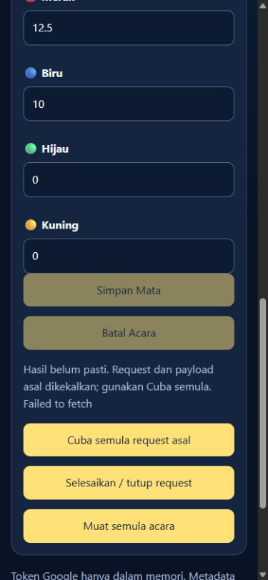

# SECURITY_V9B_QA_REPORT

**Keputusan: PASS untuk skop implementation/QA yang dinyatakan; production release masih BLOCKED.**  
Tiada tuntutan keselamatan 9/10 atau production PASS.

Repository: kevitu/championship  
Branch: security/v9-transaction-integrity-qa  
Specification: docs/SECURITY_V9B_INTEGRATION_PLAN.md, commit4093aaf33a2317359079a0e72f0709d1d7ee783a  
Code candidate akhir: **a65d55200ac0495f68d1ba2c2d4a4a6d7a79952d**  
Baseline V9-A: 4234353c947f7c5f8a1527618345b5e16bdfe7f6  
Tarikh: 1 November 2026, Malaysia.

## 1. Status berasingan

| Semakan | Keputusan | Bukti/batas |
|---|---|---|
| Baseline V9-A tepat331 | **331 PASS /0 FAIL** | Fixture source dan suite asal dipadankan dengan Git blobs sebelum disimpan. |
| Suite pada kod V9-B akhir | **438 PASS /0 FAIL** | Termasuk expanded V9-A, publication, frontend integration, worker concurrency dan public client. |
| Browser sebenar, localhost mock | **6 PASS /0 FAIL** | Chromium390×844 dan1280×900; OAuth sintetik, network drop, reload, retry dan no-overflow. |
| Independent source review | **PASS dalam skop disemak** | Reviewer berasingan membaca fail Git sebenar pada b5f3949 dan delta akhir a65d552; tiada concrete blocker dilaporkan. |
| Independent focused execution | **27 PASS** | 13 arithmetic/snapshot checks pada calon awal +14 closure/auth/export checks pada delta akhir; implementation bodies disahkan tidak berubah dalam closures. |
| Full suite dilaksanakan semula secara bebas | **NOT VERIFIED** | Reviewer membaca test/evidence tetapi tidak mengulang keseluruhan Node/worker/DOM/browser suite. |
| Google GAS/OAuth/Sheets sebenar | **NOT VERIFIED** | Tiada deployment, real Admin token, live mutative request atau fault injection production. |
| Konsistensi bukti selepas reconnect | **PASS** | Counts, coverage, SHA-256 dan remote Git blobs dipadankan; suite yang sudah selesai tidak diulang. |
| Safety LOCK | **Dipatuhi oleh tindakan sesi ini** | QA branch sahaja; tiada PR/merge/deploy/official spreadsheet/OAuth production edits. Main disemak berasingan. |

331 baseline,438 current dan27 focused independent checks bukan ukuran peratus keselamatan dan tidak digabungkan sebagai bilangan senario unik.

## 2. Kerja yang selesai

### Admin frontend
- Kontrak V9 digunakan untuk save dan cancel; cancel menerima object payload.
- UUID request_id dijana sekali per logical submission. expected_revision datang daripada verified list.
- Metadata immutable dipersist/readback sebelum RPC, diasingkan mengikut actor/scope hashes daripada backend.
- Web Locks dengan ifAvailable menghalang tab kedua daripada queue operasi baharu semasa tab pertama aktif.
- Unknown response, mismatch ACK, stale conflict dan recovery-required mengekalkan request asal serta mengunci payload.
- Reload/logout tidak membuang pending metadata; authentication baharu diperlukan. Token Google tidak dipersist.
- Hanya matching terminal result membuang pending metadata.
- Explicit close menggunakan durable CLOSED tombstone, bukan discard berdasarkan NOT_FOUND. Delayed original tidak boleh mencipta acara selepas close.
- Token replacement tidak revoke grant baharu; explicit logout melakukan revoke.
- Web Locks/UUID/storage yang tidak tersedia atau gagal menyebabkan client fail closed.
- V8 server tanpa protocol handshake tidak menerima mutation daripada client V9-B.

### Backend dan publication
- Journal plan disahkan dengan HMAC peribadi selain checksum. Recomputed public checksum sahaja tidak cukup untuk memalsukan actor/audit.
- Latest full committed/terminal state, audit completeness dan source-state commitment disemak sebelum publication.
- Hanya COMMITTED state diterbitkan; PREPARED tidak boleh dipublish.
- Immutable snapshot row ditulis/readback, kemudian signed pointer cell ditulis/readback.
- Publication gagal selepas COMMITTED meninggalkan last-known-good coherent snapshot. New writes/list diblok sehingga retry/recovery menyelesaikan publication.
- Generation mengira COMMITTED sahaja; CLOSED tidak menambah generation.
- Pin workbook, Session whitelist dan OAuth configuration sedia ada dikekalkan.

### Public Reader dan dashboard
- Reader hanya membaca V9_PUBLIC_POINTER dan V9_PUBLIC_SNAPSHOTS. Ia tidak membaca physical business tables atau berkongsi lock dengan Bridge.
- Descriptor HMAC mengikat workbook scope, schema, row, payload hash, committed generation, source_hash dan publication/expiry.
- Dua bacaan descriptor mesti tepat sama; snapshot/schema/hash/signature/generation disahkan sebelum respons.
- Duplicate event ID termasuk BATAL ditolak. Decimal totals/ties sama dengan backend.
- Cache maksimum60s; signed24h expiry dikuatkuasakan pada setiap hit. Tiada raw-table fallback.
- Tiada personal/audit actor records dipulangkan. Invalid output hanya memberikan generic data-unavailable.
- Perubahan kecil app.js memerlukan publication provenance, menunjukkan masa snapshot sebenar dan mengekalkan nilai akhir fractional counter. Tiada dashboard redesign.

### Helper surface
Semakan akhir mendapati sensitive helper globals wujud pada calon b5f3949. Ini direkod sebagai source-level RED; **tiada eksploitasi sebenar Execution API/LIVE dicuba**. Sekatan underscore didokumenkan bagi google.script.run tidak digunakan sebagai jaminan untuk Execution API.

Pada a65d552, semua key/config/signing/transaction helpers menjadi lexical closure locals. Bridge mengeksport hanya lapan API berautentikasi serta doGet/doPost yang tidak memutasi. Reader mengeksport hanya doGet/publicSnapshot_ read-only. Ujian source dan semakan bebas mengesahkan sensitive helper names tidak global. Routing sebenar platform masih NOT VERIFIED.

## 3. Pecahan438 semakan kod semasa

| Suite | PASS | FAIL |
|---|---:|---:|
| Expanded V9-A regression pada V9-B |373|0|
| Enam worker scenarios V9-A pada V9-B |6|0|
| Publication, signing, closure, auth, limits, Reader |40|0|
| Admin DOM integration |12|0|
| Additional worker concurrency + independent Reader sampling |3|0|
| Public client provenance/expiry/fractional display |4|0|
| **Jumlah** |**438**|**0**|

Semua325 assertion IDs dan enam worker scenario IDs asal masih hadir. Mock provisioning ditambah dengan snapshot bootstrap sintetik/key sintetik; authenticated capacity fixture di-seal semula supaya kekal mewakili2,000 rekod sah. Assertion kapasiti/rejection tidak dilemahkan.

Fixture immutable V9-A di tests/security-v9b/v9a-baseline membolehkan baseline tepat331 diulang secara berasingan. Ia bukan backend yang akan dideploy.

### Fault injection
| Laluan | Write/flush boundaries | Before+after cases |
|---|---:|---:|
| Create |35|70|
| Edit |23|46|
| Cancel |21|42|
| Recovery create |31|62|
| Recovery edit |19|38|
| Recovery cancel |17|34|
| **Jumlah** |**146**|**292**|

Empat kes tambahan mengganggu CLOSED journal write/flush sebelum dan selepas application. State dibina semula daripada persisted mock selepas gangguan. Retry/recovery memeriksa ACARA, MATA_ACARA, KEDUDUKAN, LOG_MATA, journal dan publication.

Coverage termasuk lost ACK, duplicate submit selepas restart, two-Admin stale edit, cancel retry, audit hilang, header/formula rosak, actor/request conflict, wrong workbook/key/scope, expiry/future pointer, descriptor berubah semasa read, tampering dengan checksum yang dikira semula, legacy audit tamper, snapshot row/cell limits dan helper surface.

### Concurrency
- Dua real Node workers dengan shared Sheets mock dan Atomics-backed mock LockService.
- Enam scenario lama: same-ID duplicate create, independent creates, stale two-Admin edit, cancel-vs-edit, duplicate cancel, retry-vs-recovery.
- Tiga scenario tambahan: concurrent saves dengan Reader samples, original-vs-CLOSED race, same-ID different-actor race.
- Reader dijalankan dalam VM berasingan pada setiap persisted boundary; ia tidak menggunakan writer lock.
- Hasil membuktikan protocol dalam model ini, bukan semantik waiting/fairness/quota Google sebenar.

## 4. Browser sebenar — bukti terhad yang nyata

Actual in-app Chromium, localhost sahaja:
1. Synthetic sign-in membolehkan verified controls.
2. Network drop selepas committed save menghasilkan transport retry dengan request ID/payload sama.
3. Pada390px, hasil unknown mengunci input/save/cancel dan memaparkan retry/close; tiada horizontal overflow.
4. Selepas reload, authentication diperlukan semula dan pending request masih dikunci.
5. Selepas network mock dinormalkan, retry memulangkan matching stored result; **satu acara, empat audit rows**, tiada duplicate.
6. Pada1280px, hasil disahkan, controls pulih dan tiada horizontal overflow.

Tiga transport attempts menggunakan payload sama. Source hashes browser evidence padan dengan kod akhir. GIS sebenar dibuang daripada test page; fetch diarahkan ke mock lokal dan CSP menghalang external connections. Tiada real Google credentials digunakan. Tab/viewport override dan server sementara telah dibersihkan.

Ini bukan ujian physical iPhone/Android/Safari atau real Google consent/session. Reproduction helper: tests/security-v9b/browser-server.cjs.

## 5. Independent review

Reviewer berasingan v9b_reviewer:
- Membuktikan access dengan membaca actual spec dan source4093aaf.
- Membaca sembilan actual candidate paths pada b5f3949 melalui GitHub, termasuk implementation, tests dan browser evidence.
- Menjalankan13 pure JavaScript checks daripada actual source: tujuh decimal parity vectors, valid empty snapshot serta lima rejection cases.
- Membaca semula dua actual GAS files pada a65d552 selepas closure hardening.
- Menjalankan14 checks: sensitive globals tidak tersedia, frozen exact exports, kesemua lapan Bridge wrappers menolak anonymous mocked Session, Reader safe exports dan identical implementation bodies.
- Melaporkan tiada concrete blocker dalam reviewed scope; realistic capacity termasuk bootstrap dicatat.
- Tiada mutation dilakukan oleh reviewer.

**Batas:** full Node/worker/DOM/browser suite tidak dijalankan semula secara bebas. Real Execution API routing/Google services juga tidak diverifikasi. Rekod ini tidak dinaikkan taraf menjadi independent full-suite PASS.

Bukti: tests/security-v9b/evidence/independent-review.json.

## 6. Semakan konsistensi selepas sambungan terputus

HEAD diperiksa: a65d55200ac0495f68d1ba2c2d4a4a6d7a79952d.  
Main diperiksa: 5babbe255a26beb330d5db9ca80b03d9dfaa6512.

Semasa finalisasi, QA HEAD bergerak kepada9d71707cee2d907882ae5031230743da43b09f29 dengan empat PNG logo tambahan sahaja. Tambahan itu dikekalkan; kod dan test evidence tidak berubah. Commit dokumentasi diletakkan secara linear di atas HEAD baharu menggunakan expected-head lease.

Tanpa mengulang suite selesai:
- Suite totals dibandingkan dengan result arrays dan summary438.
- Baseline325+6=331 serta retention semua original case IDs disahkan.
- Source SHA-256 dalam summary/browser/regression dipadankan.
- Lima core source files dipadankan dengan remote Git blobs.
-31 existing test/evidence files dipadankan dengan remote bytes.
- Browser event/audit counts dan sumber yang diuji disahkan konsisten.

Hash source akhir:
| Fail | SHA-256 |
|---|---|
| gas/bridge/Code.gs | e9298ffafa65242d7dd958a7f3fa00f29046bd5493d781ade0191db72a2419f3 |
| gas/public/Code.gs | 7d83ce171e4aa898275823c47f1c9ef5d7504b3ee8a69f4c3498ed3828269ae5 |
| admin-auth.js | 331c728c6804f41c88bfe5106c7ac4a748b54a2ee1ebe8c26e5393e36f305ced |
| admin.html | 18f26d9e75a688d6b5724fe88cb658bbc11e64f5dc2e6c3ae473515aac6fd5c3 |
| app.js | a0403761f8d1bd0ff4dcd0881ae58b8ac5eaebb86c4e89d7f383157de8217d66 |

Bukti: evidence-consistency.json. Final documentation commit hanya menambah/melengkapkan dokumen dan rekod bukti; source calon akhir tidak berubah.

Legacy55 dengan14 FAIL serta files berlabel RED ialah sejarah daripada kod lama. Ia tidak dicampur sebagai438 keputusan semasa. Public Reader defect yang deferred dalam laporan V9-A kini diuji dan ditutup dalam V9-B.

## 7. Risiko dan release blockers

Tiada unresolved Critical/High implementation defect dibuktikan dalam skop QA akhir. Namun **release production belum diluluskan** kerana:

| Perkara | Status / kesan |
|---|---|
| Real GAS, export routing, caller identity, ACL, quotas, flush/coercion | NOT VERIFIED; staging gate sebelum release. |
| Secure key custody, tujuh schema/protections, legacy reconciliation dan bootstrap | Belum dilaksanakan pada real environment; wajib sebelum cutover. |
| Coordinated Admin/Bridge/Reader cutover | BLOCKER; jangan campur V8 raw Reader dengan V9 writer atau client contracts berlainan. |
| Full independent suite execution | NOT VERIFIED; owner perlu menentukan gate tambahan sebelum release. |
| Physical mobile/browser matrix | NOT VERIFIED; Chromium viewport dan DOM tests tidak menggantikannya. |
| Heartbeat, capacity dan key rotation | Operational gate: expired snapshot fail closed; bootstrap menggunakan satu row; tiada automatic archive/key-ring. |
| Direct editors/project editors | Sheet tamper tanpa key dikesan; editor yang menguasai private key/source ialah trusted principal. Deletion/DoS tidak dapat dicegah oleh protocol ini. |
| Valid old signed pointer replay | Bounded stale sehingga signed expiry; coherent snapshot tidak bermaksud latest-state proof mutlak. |
| Restore lama | Boleh kehilangan request registry/outcomes; perlu coherent all-tab restore dan reconciliation. |
| Availability/abuse | Tiada flood/stress test production. Cache dan bounds bukan bukti DDoS resistance. |

Pelan lengkap dengan schema, ownership, gating, freshness, migration, deployment, recovery, rollback dan stop criteria:
[SECURITY_V9B_RELEASE_RUNBOOK.md](docs/SECURITY_V9B_RELEASE_RUNBOOK.md).

## 8. Reproduksi dan fail serahan

~~~powershell
node tests/security-v9b/run.cjs
node tests/security-v9b/browser-server.cjs
~~~

Perintah ini untuk mock/isolated QA sahaja. Tiada suite diulang dalam fasa reconnect kerana source dan bukti sepadan.

Fail utama:
- admin-auth.js, admin.html — kontrak/persistent retry UX.
- gas/bridge/Code.gs — journal, closure/tombstone, authenticated publication.
- gas/public/Code.gs — read-only signed snapshot Reader.
- app.js — provenance/freshness text dan fractional display.
- tests/security-v9b/ — runner, fixtures, DOM/worker/publication/browser helpers dan evidence.
- tests/security-v9/mock.cjs dan regression.cjs — fixture adaptation dengan original assertions dikekalkan.
- docs/SECURITY_V9B_INTEGRATION_PLAN.md — spec asal, tidak ditulis semula.
- docs/SECURITY_V9B_EXECUTION.md — execution ledger.
- docs/SECURITY_V9B_RELEASE_RUNBOOK.md — release/rollback plan.
- SECURITY_V9B_QA_REPORT.md — laporan ini.

Source review SHA ialah a65d552. SHA commit dokumentasi terakhir dan pengesahan remote/main direkodkan dalam delivery receipt selepas commit supaya tiada self-referential SHA direka dalam laporannya sendiri.

## 9. Safety dan stop

Tiada PR, merge, deploy GAS/GitHub Pages, mutasi official spreadsheet, perubahan OAuth production, real Admin-token test, stress/flood atau fault injection LIVE. Push hanya ke security/v9-transaction-integrity-qa. Existing main ref dibandingkan semula selepas final push.

Kerja dihentikan selepas dokumen, bukti dan QA-only push. Production menunggu semakan serta release approval pemilik.
